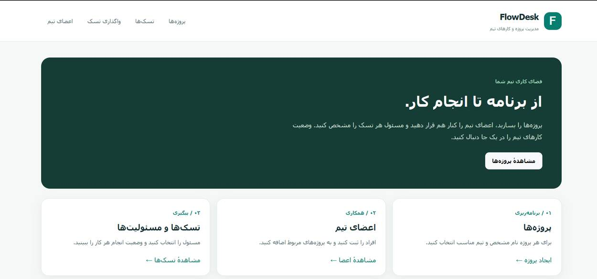
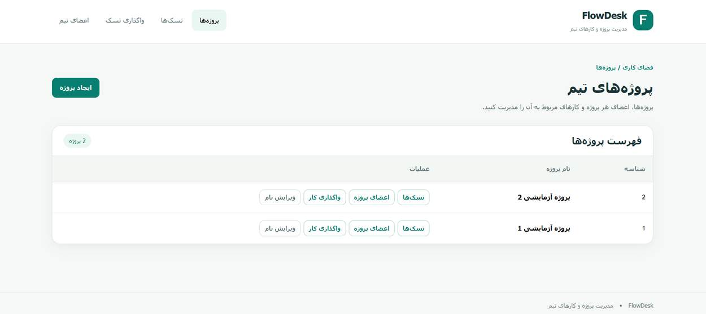
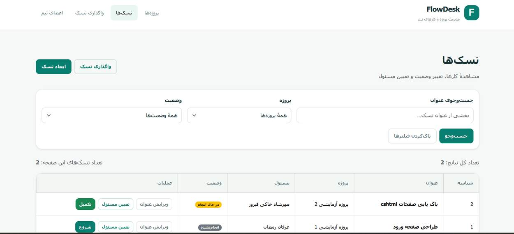
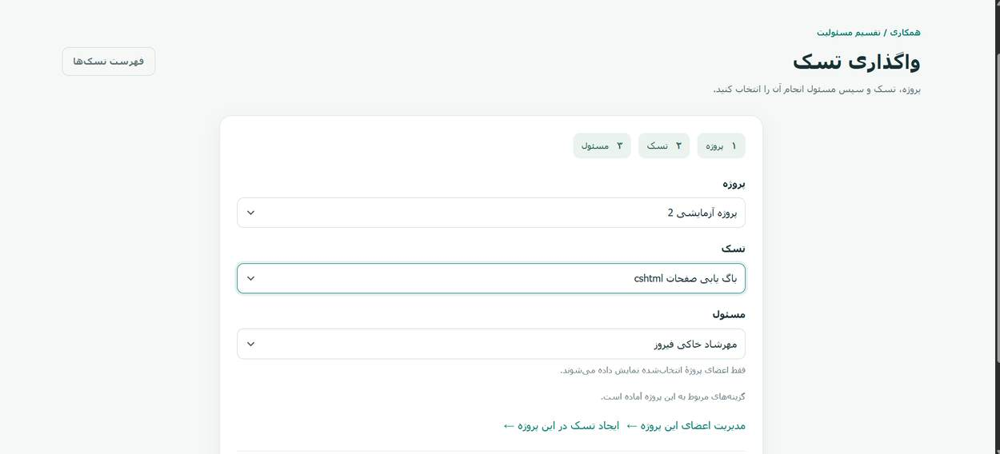
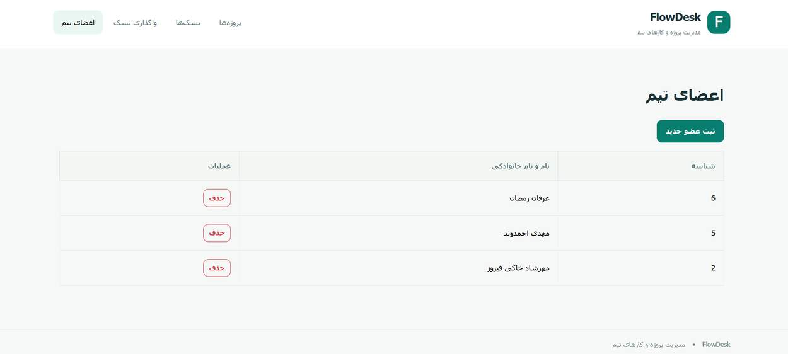

# FlowDesk

### سامانه مدیریت پروژه‌ها، اعضای تیم و وظایف

**FlowDesk** یک برنامه تحت وب برای سامان‌دهی کارهای تیمی است. در این سامانه می‌توان پروژه تعریف کرد، اعضای تیم را مدیریت کرد، وظایف هر پروژه را ثبت و پیگیری کرد و مسئول انجام هر وظیفه را مشخص کرد.

`C#` · `ASP.NET Core / .NET 10` · `Entity Framework Core` · `SQL Server` · `Onion Architecture` · `RTL Interface`



## قابلیت‌های فعلی

| بخش | امکانات |
| :--- | :--- |
| **پروژه‌ها** | مشاهده فهرست پروژه‌ها، ایجاد پروژه و ویرایش نام آن |
| **اعضای تیم** | ثبت عضو، نمایش اعضا و حذف عضو از فهرست |
| **مدیریت وظایف** | ایجاد وظیفه، مشاهده وظایف پروژه‌ها و ویرایش عنوان |
| **جست‌وجو و فیلتر** | جست‌وجوی وظیفه بر اساس عنوان و فیلتر بر اساس پروژه و وضعیت |
| **واگذاری وظیفه** | انتخاب پروژه و وظیفه، سپس انتخاب مسئول از اعضای پروژه |
| **پیگیری پیشرفت** | نمایش وضعیت وظایف و انجام عملیات شروع یا تکمیل بر اساس وضعیت فعلی |

## تصاویر محیط برنامه

### ۱. مدیریت پروژه‌ها

در بخش پروژه‌ها، فهرست پروژه‌های تعریف‌شده همراه با عملیات مرتبط نمایش داده می‌شود.



### ۲. فهرست و مدیریت وظایف

وظایف بر اساس پروژه، عنوان و وضعیت قابل جست‌وجو و فیلتر هستند. عملیات مربوط به هر وظیفه در همان فهرست در دسترس است.



### ۳. واگذاری وظیفه

فرایند واگذاری در سه مرحله انجام می‌شود: **انتخاب پروژه ← انتخاب وظیفه ← تعیین مسئول**. فهرست مسئول‌ها بر اساس اعضای پروژه انتخاب‌شده نمایش داده می‌شود.



### ۴. مدیریت اعضای تیم

در این صفحه می‌توان اعضای ثبت‌شده را مشاهده و مدیریت کرد.



## ساختار فنی پروژه

پروژه بر اساس الگوی **Onion Architecture** سازمان‌دهی شده است. هدف این ساختار، جدا نگه داشتن قوانین دامنه از رابط کاربری و جزئیات دسترسی به داده است.

| لایه | مسئولیت |
| :--- | :--- |
| `FlowDesk.Domain` | موجودیت‌ها، وضعیت‌ها و قواعد اصلی کسب‌وکار |
| `FlowDesk.Application` | سناریوهای کاربردی، سرویس‌ها، DTOها و قراردادهای Repository |
| `FlowDesk.Infrastructure` | پیاده‌سازی دسترسی به داده با EF Core و SQL Server |
| `FlowDesk.Web` | رابط کاربری ASP.NET Core MVC، کنترلرها و صفحات |

### ساختار پوشه‌ها

```text
FlowDesk/
├── FlowDesk.Web/           # ASP.NET Core MVC, Controllers, Views
├── src/
│   ├── FlowDesk.Domain/    # Entities, business rules
│   ├── FlowDesk.Application/  # Services, DTOs, interfaces
│   └── FlowDesk.Infrastructure/  # EF Core, DbContext, migrations
└── FlowDesk.slnx
```

**اصل وابستگی:** لایه‌های داخلی به جزئیات رابط وب یا پایگاه داده وابسته نیستند. قراردادهای موردنیاز در لایه Application تعریف می‌شوند و پیاده‌سازی آن‌ها در Infrastructure قرار می‌گیرد.

## قواعد اصلی سامانه

- هر وظیفه به یک پروژه مشخص تعلق دارد.
- هنگام واگذاری وظیفه، فرد انتخاب‌شده باید عضو همان پروژه باشد.
- وضعیت وظیفه از میان `ToDo`، `InProgress` و `Done` مدیریت می‌شود.
- تغییرات داده‌ها از طریق سرویس‌ها و لایه دسترسی به داده ثبت می‌شوند.
- نمایش و اعتبارسنجی فرم‌ها به‌تنهایی جایگزین کنترل قواعد در سمت سرور نیست.

## فناوری‌های مورد استفاده

- **Backend:** C# و ASP.NET Core (.NET 10)
- **Data Access:** Entity Framework Core
- **Database:** Microsoft SQL Server
- **UI:** ASP.NET Core MVC و صفحات راست‌به‌چپ فارسی
- **Architecture:** Onion Architecture، Dependency Injection و Repository Pattern

## اجرای محلی

**پیش‌نیازها:** .NET SDK 10، SQL Server و یک محیط توسعه مانند Visual Studio.

۱. مخزن پروژه را دریافت و در پوشه اصلی آن ترمینال باز کنید.

۲. رشته اتصال SQL Server را متناسب با تنظیمات محیط خود در پیکربندی برنامه تنظیم کنید. **اطلاعات اتصال واقعی، رمز عبور یا فایل‌های محرمانه را در Git ثبت نکنید.**

۳. وابستگی‌ها را بازیابی و پروژه را بیلد کنید:

```bash
dotnet restore FlowDesk.slnx
dotnet build FlowDesk.slnx
```

۴. دیتابیس را با Migrationهای موجود آماده کنید. ابزار `dotnet-ef` باید نصب باشد:

```bash
dotnet ef database update --project src/FlowDesk.Infrastructure --startup-project FlowDesk.Web
```

۵. پروژه وب را اجرا کنید:

```bash
dotnet run --project FlowDesk.Web/FlowDesk.Web.csproj
```

> برای اجرا، SQL Server محلی و رشته اتصال معتبر ضروری است. تنظیمات نمونه فقط برای محیط توسعه هستند.

> **امنیت:** نسخه فعلی صرفاً نمونه توسعه‌ای است و ورود/مجوزدهی کاربران در کد فعلی پیاده‌سازی نشده است؛ بدون افزودن Authentication و Authorization نباید روی اینترنت عمومی منتشر شود.

## وضعیت توسعه

FlowDesk در حال توسعه و تکمیل است. بخش‌های پروژه‌ها، اعضای تیم، فهرست وظایف و واگذاری وظیفه در تصاویر بالا نمایش داده شده‌اند. احراز هویت، کنترل دسترسی مبتنی بر نقش، تست‌های خودکار و استقرار امن هنوز جزو قابلیت‌های تأییدشده این نسخه نیستند. نمودارها و مستندات توسعه نیز نباید با امکانات پیاده‌سازی‌شده اشتباه گرفته شوند.

---

**FlowDesk** — مدیریت پروژه و کارهای تیمی در یک محیط یکپارچه.