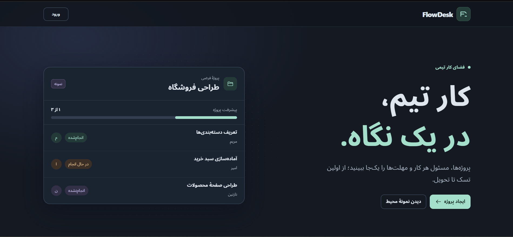
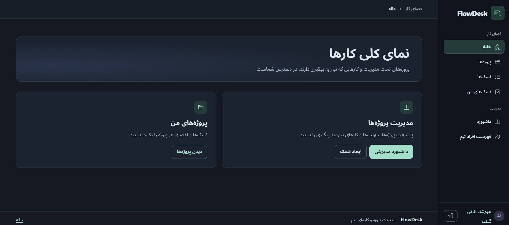
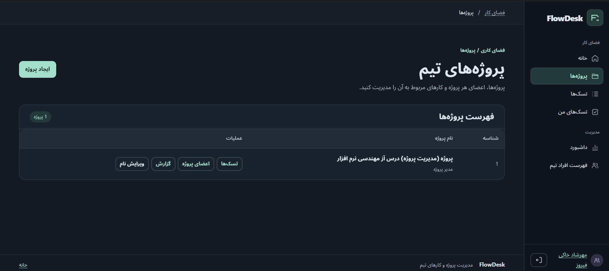
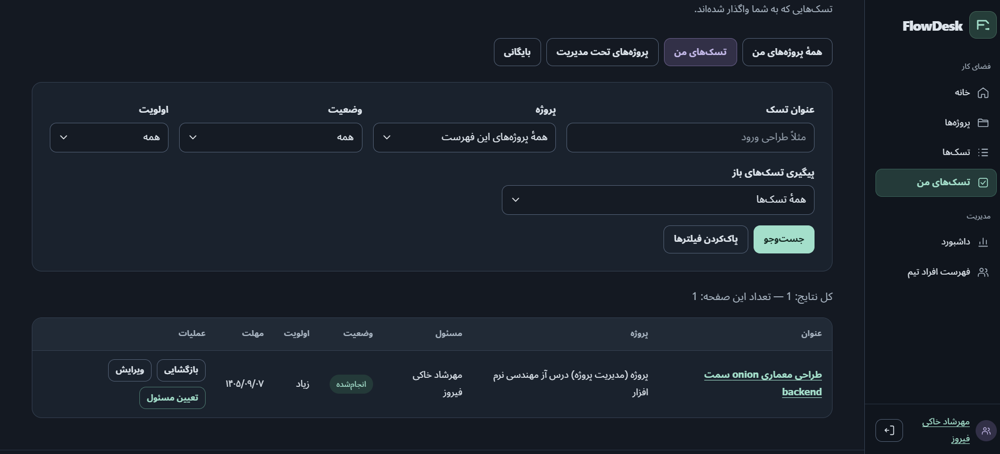
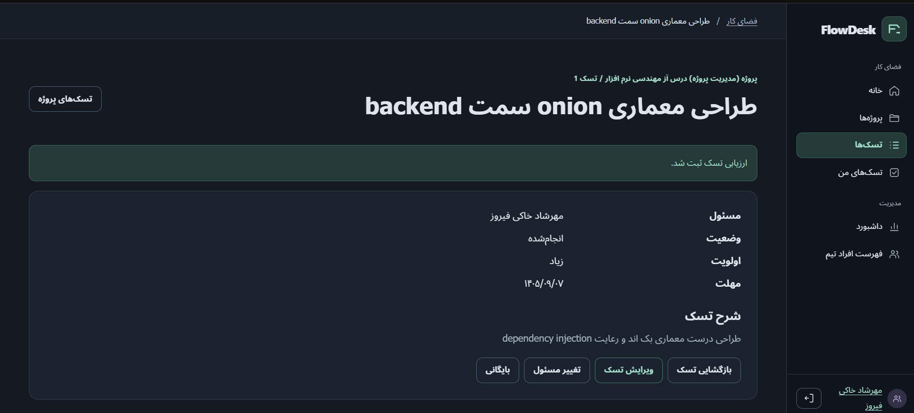
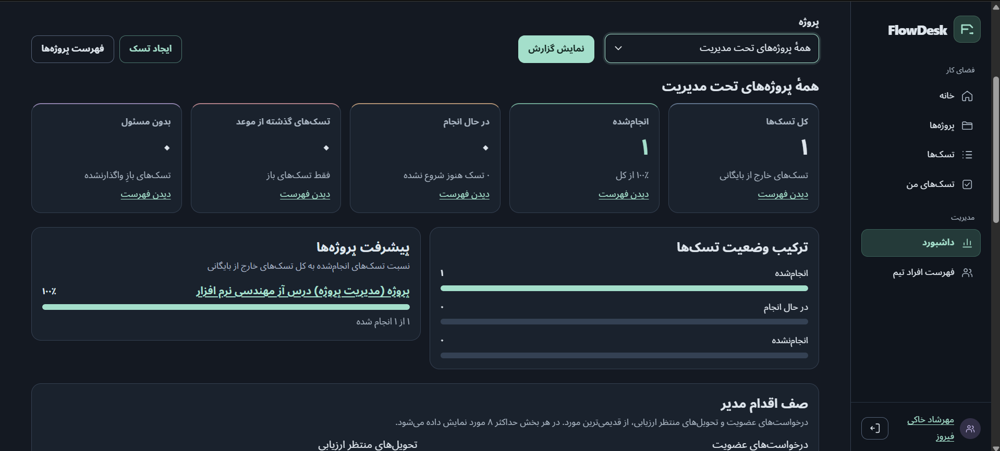

# FlowDesk

FlowDesk یک فضای کار فارسی برای مدیریت پروژه، واگذاری تسک و پیگیری کار تیم است. مدیر پروژه می‌تواند تحویل‌ها، مهلت‌ها و وضعیت کار اعضا را از یک داشبورد ببیند؛ اعضا هم از بخش «تسک‌های من» کارهای واگذارشده را دنبال می‌کنند.

**[مشاهدهٔ دمو](https://mehrshadkhaki-001-site1.ctempurl.com/)** · [نسخه‌ها](https://github.com/khakifirooz/FlowDesk/releases)



## قابلیت‌ها

| بخش | امکانات |
| --- | --- |
| حساب و پروفایل | ثبت‌نام و ورود با ایمیل، تعیین نام نمایشی و ویرایش عنوان شغلی و معرفی کوتاه |
| پروژه و تیم | ایجاد پروژه، ثبت افراد، دعوت یا اتصال حساب به عضویت پروژه و تأیید درخواست عضویت |
| تسک‌ها | واگذاری به اعضای همان پروژه، تعیین مهلت و اولویت، جست‌وجو، فیلتر، تغییر وضعیت و بایگانی |
| همکاری و ارزیابی | ثبت فعالیت و دیدگاه، ثبت نمره یا بازخورد برای تحویل تسک از سوی مدیر پروژه |
| داشبورد مدیر | پیشرفت پروژه‌ها، کارهای عقب‌افتاده یا بدون مسئول، بار کاری اعضا و تحویل‌های منتظر بررسی |

## تور تصویری

<details>
<summary>فضای کار و پروژه‌ها</summary>





</details>

<details>
<summary>تسک‌های من و ارزیابی تحویل</summary>





</details>

<details>
<summary>داشبورد مدیر</summary>



</details>

## معماری

پروژه از **C# / .NET 10**، **ASP.NET Core MVC**، **ASP.NET Core Identity**، **EF Core** و **SQL Server** استفاده می‌کند. رابط کاربری فارسی و راست‌به‌چپ است.

| لایه | مسئولیت |
| --- | --- |
| `src/FlowDesk.Domain` | موجودیت‌ها و قواعد دامنه، از جمله وضعیت تسک و اعتبار دعوت |
| `src/FlowDesk.Application` | سرویس‌ها، بررسی دسترسی پروژه، قراردادها و مدل‌های انتقال داده |
| `src/FlowDesk.Infrastructure` | پیاده‌سازی دسترسی به داده، Identity و Migrationها |
| `FlowDesk.Web` | کنترلرها، فرم‌ها، صفحات Razor و تنظیمات برنامه |

ثبت فرد در فهرست تیم به او دسترسی ورود نمی‌دهد؛ دسترسی به پروژه به عضویت همان پروژه و اتصال آن به حساب کاربری وابسته است.

## اجرای محلی

**پیش‌نیازها:** .NET SDK 10، SQL Server و ابزار `dotnet-ef` نسخهٔ ۱۰. دستورها را از پوشهٔ اصلی مخزن اجرا کنید.

۱. مقدار `ConnectionStrings:FlowDeskConnection` را برای محیط توسعه تنظیم کنید. نمونهٔ زیر را با مشخصات دیتابیس محلی خود جایگزین کنید. رمز محیط واقعی را در مخزن ذخیره نکنید.

```bash
dotnet user-secrets init --project FlowDesk.Web
dotnet user-secrets set "ConnectionStrings:FlowDeskConnection" "Server=YOUR_LOCAL_SQL_SERVER;Database=FlowDesk;Trusted_Connection=True;TrustServerCertificate=True" --project FlowDesk.Web
```

۲. هر دو مجموعهٔ Migration را روی همان دیتابیس اعمال کنید. جدول‌های برنامه و Identity تاریخچهٔ Migration جدا دارند.

```bash
dotnet ef database update --context FlowDeskDbContext --project src/FlowDesk.Infrastructure --startup-project FlowDesk.Web -- --environment Development
dotnet ef database update --context FlowDeskIdentityDbContext --project src/FlowDesk.Infrastructure --startup-project FlowDesk.Web -- --environment Development
```

۳. برنامه را با پروفایل HTTPS اجرا کنید و از صفحهٔ ورود یک حساب بسازید.

```bash
dotnet dev-certs https --trust
dotnet run --project FlowDesk.Web --launch-profile https
```

## تست و انتشار

```bash
dotnet test FlowDesk.slnx -c Release
dotnet publish FlowDesk.Web -c Release -o artifacts/publish
```

تست‌های xUnit قواعد وضعیت تسک، تأیید دعوت و ارزیابی را بررسی می‌کنند. تست‌های حذف حساب از SQLite در حافظه استفاده می‌کنند و به دیتابیس هاست دست نمی‌زنند.

حذف حساب فعلاً قابلیت آزمایشی و خاموش است. برای آزمایش با حساب و دیتابیس جدا، متغیر محیطی `Features__AccountDeletion=true` را تنظیم کنید. حذف به تأیید و رمز فعلی نیاز دارد؛ تا وقتی حساب مدیر یک پروژه یا متصل به عضویت پروژه باشد، مسدود می‌ماند. پروژه‌ها، تسک‌ها و سوابق مشترک با نام ثبت‌شده حفظ می‌شوند.
